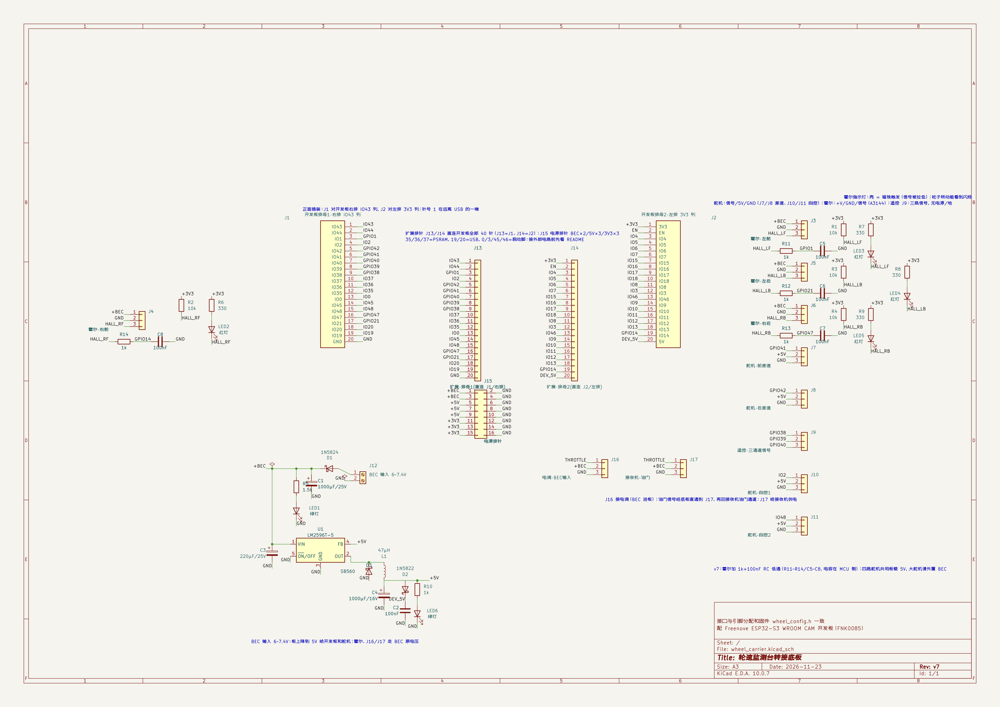
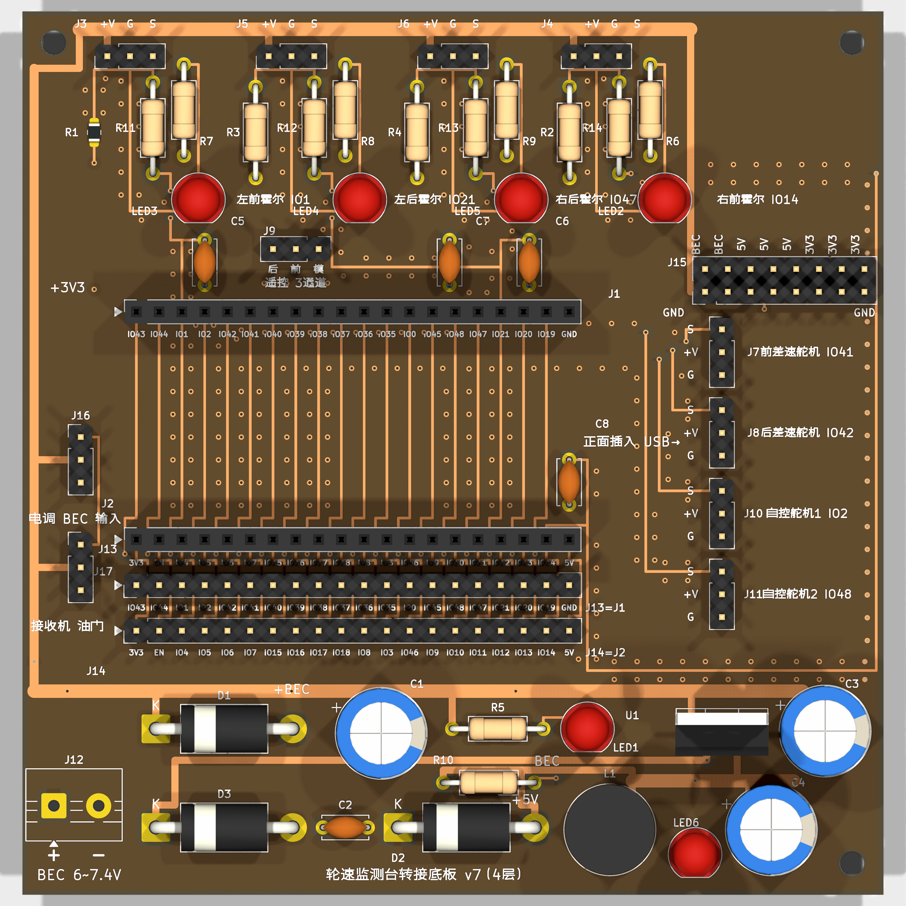

# 转接底板（硬件 v7：4 层板、霍尔 RC 滤波、四路舵机）

轮速监测台的转接底板：原理图 + PCB 布局布线，全部脚本生成。Freenove
ESP32-S3 WROOM CAM 开发板**正面朝上**插在底板的两个 20 针排母上（J1 对右排
IO43 列，J2 对左排 3V3 列），霍尔、舵机、遥控、电源的接线全部从底板的端子上走；
开发板全部 40 针另有 1:1 的扩展排针。板子 **96 × 98.5mm**、**4 层**、三个
M2.5 安装孔，继续落在嘉立创 100×100 打样档内。

v7 在 v6 基础上做了四件事：**4 层叠层**（In1 整面 GND、In2 三路电源分割）、
**四路霍尔统一加 1k + 100nF RC 低通**（右前 GPIO14 被相机 PCLK/XCLK 耦合的
毛刺在源头压掉）、**全板信号地过孔围栏**、**新增两路自控舵机 J10/J11**
（GPIO2/48，固件已带 LEDC bring-up，MPU6050 自动控制逻辑后续再做）。





- **图纸**：用 KiCad 打开 `wheel_carrier/wheel_carrier.kicad_pro`（双击即可）。
- **生成器**：`scripts/gen_schematic.py`（原理图）+ `scripts/gen_pcb.py`（PCB），
  内容全是脚本里的常量，改完重跑就出新版。
- **验证状态**：原理图 ERC **0 错误 0 警告**；PCB DRC **0 错误 0 警告 0 未连接**
  （含丝印/外框类，`--refill-zones --save-board` 后全零）；Gerber + 钻孔文件
  已导出（`wheel_carrier/wheel_carrier-gerber.zip`），含 **In1_Cu/In2_Cu** 两层。

## 这块板做什么

| 项目 | 说明 |
|---|---|
| 开发板封装 | 2 个 20 针排母（J1 顶排 = 开发板右排 IO43 列，J2 底排 = 左排 3V3 列），**正面插装** |
| 扩展排针 | **J13/J14 直连开发板全部 40 针（1:1）**；J15 电源条（2×8，BEC×2 / 5V×3 / 3V3×3 + 8 地） |
| 电调 / 油门 | J16 收电调的 3 针插头（BEC 进板）；油门信号经底板直通到 J17 → 接接收机油门通道 |
| 电源输入 | J12 两针螺丝端子进 **BEC 6~7.4V**（电调 BEC 输出），位置固定（装车线束基准） |
| +BEC 主路 | 防反接后分给：J3~J6 霍尔的 +V、J17、J15 的 BEC 针、C1 大电容、降压段 |
| 5V 降压 | LM2596T-5.0 + 47µH 电感 + 续流管 + 输入/输出电容，5V 供开发板和**四路**舵机 |
| 防倒灌 | D2 串在给开发板的支路上，USB 与底板供电互不倒灌 |
| 霍尔 ×4 | J3 左前 / J4 右前 / J5 左后 / J6 右后，脚序 **+V / GND / 信号**（对 A3144），各配 10k 上拉到 3.3V |
| 霍尔滤波 | 每路 **1k 串阻 R11~R14 + 100nF 对地 C5~C8**；上拉/指示灯在传感器侧，电容贴 MCU 引脚 |
| 霍尔指示 | 每路信号一个 330R + 红灯：**亮 = 磁铁触发**（信号被拉低），转起来能看到闪烁 |
| 舵机 ×4 | J7 前差速 / J8 后差速 / J10 自控 1 / J11 自控 2，+V 固定为板载 **5V** |
| 遥控 | J9 一个 3 针排针：1=模式 / 2=前差速 / 3=后差速，**只走信号**；接收机电源/地走 J17 |
| 大电容 | C1 1000µF/25V 兜输入母线；C4 1000µF/16V 兜 5V 舵机堵转 |
| 指示灯 | LED1 绿灯 = +BEC 已上电；LED6 绿灯 = 降压段有 5V 输出 |

接口脚序：**舵机 J7/J8/J10/J11 是 信号 / +5V / GND；霍尔 J3~J6 是 +V(BEC) /
GND / 信号（A3144 的 1=VCC、2=GND、3=OUT）；遥控 J9 只有三路信号，没有电源和地。**
信号脚的 GPIO 分配与固件 `main/wheel_config.h` 完全一致。

### 引脚映射（与固件 wheel_config.h 一致）

| 接口 | 接到开发板排针 | GPIO |
|---|---|---|
| 霍尔·左前 J3 | J1 第 3 针 | 1 |
| 霍尔·右前 J4 | J2 第 19 针 | 14 |
| 霍尔·左后 J5 | J1 第 17 针 | 21 |
| 霍尔·右后 J6 | J1 第 16 针 | 47 |
| 舵机·前差速 J7 | J1 第 6 针 | 41 |
| 舵机·后差速 J8 | J1 第 5 针 | 42 |
| 舵机·自控 1 J10 | J1 第 4 针 | 2 |
| 舵机·自控 2 J11 | J1 第 15 针 | 48 |
| 遥控 J9·1 模式 | J1 第 9 针 | 38 |
| 遥控 J9·2 前差速 | J1 第 8 针 | 39 |
| 遥控 J9·3 后差速 | J1 第 7 针 | 40 |
| 开发板 5V 输入 | J2 第 20 针 | — |
| 开发板 3.3V（上拉与指示取电） | J2 第 1 针 | — |
| 开发板 GND | J1 第 20 针 | — |

排针针号 1 从**远离 USB 口**的一端数起，四个 20 针排针的 1 脚都在最左端
（丝印上有实心三角标），每一针的网名（3V3 / IO4 / IO47…）都印在排针旁边，
装板前对一遍即可。J13/J14 的针号与 J1/J2 一一对应（J13 第 n 针 = J1 第 n 针，
J14 = J2），排针右端另有 J13=J1、J14=J2 标注。

### 扩展排针的用法与红线

将来固件要用新 GPIO（比如 IMU 的 I2C），把杜邦线插到 J13/J14 对应针上就行。
引出的脚跟排母是 1:1 并联的，接外设等于并联一支，原功能不受影响。但有几条红线：

| 引脚 | 情况 |
|---|---|
| 2 / 48 | **v7 起接自控舵机 J10/J11**；板载 LED 常亮/微闪、WS2812 乱闪属预期，不要再外接 |
| 35 / 36 / 37 | PSRAM 数据线，接任何外部电路都会把 PSRAM 弄坏（能拿表测，不能接东西） |
| 19 / 20 | 原生 USB 的 D-/D+。用 USB 口烧录/调试时不能接；改走 CH343 口烧录才可复用 |
| 0 / 3 / 45 / 46 | 启动模式脚：上电瞬间被采样，外部电路拉着它们会进不了正常启动 |
| 4–18 | 摄像头位（IO4/IO5 是 I2C）。要复用先拔摄像头排线；后续 IMU 只能与摄像头共用 IO4/IO5 |
| 43 / 44 | 板载 CH343 串口，占着烧录通道，别动 |

### 电源条（J15）与电调口（J16/J17）

- **J15 是 2×8 电源条**：电源排 8 针（西→东：**BEC、BEC、5V、5V、5V、3V3、3V3、3V3**），
  另一排 8 针全是对应的 GND——每一列「电源 + 地」相邻，两针的杜邦壳插一列就能给
  传感器供电。**v7 的电压顺序与 v6 相反（v6 是 3V3→BEC），接线前看丝印。**
- **J16 收电调的 3 针插头**：BEC 电压从这里进板（三针插头中间那根必是 +V，
  插反只会信号线和地线换位，电源接不反），油门信号也从这里进板。
- **J17 去接收机**：用三针杜邦线接到接收机的油门通道。板载直通走线把 J16/J17 的
  信号针连通——油门信号「过板」，但那根直通是纯铜走线，**板子不通电也照传信号**，
  主控不在线不会断油门；J17 的 +V 是接收机唯一的电源入口。
- **遥控 J9**：一个 3 针信号排针，1=模式、2=前差速、3=后差速；接收机的电源和地
  仍从 J17 取，接线时 J17 必须插上，否则三路信号没有参考地。v7 把 J9 摆在板中部
  （霍尔与 MCU 之间），丝印脚序照旧。
- 进电方式二选一（或都用）：J12 螺丝端子（粗线 / 大电流）或 J16（即插即用）。
  **同一时间只允许一个电源来源**——别把两路不同电源同时接进这两种入口。

## 设计决定的理由

**为什么升 4 层。** v6 是双层板，右前霍尔信号（GPIO14）被相机 PCLK/XCLK
（GPIO13/15）耦合出假脉冲，软件只能压到 ~5 RPM 的瞬时波动。v7 用四层板从
结构上解决：**In1 整面 GND** 给所有信号就近回流，**In2 三块电源平面**把
+BEC/+5V/+3V3 的大电流从表层挪走，F/B 两层留给信号和局部短接。代价是打样
价格从 100×100 双层档升到四层档，换来的是右前方这块心病和更稳的舵机大电流。

**In2 电源怎么分。** 顶带 `y<32.5` 是 +3V3（霍尔上拉/330R、J15 的 3V3 列）；
左下 L 形 `x<60,y>72` + 左侧带是 +BEC（J12/D1/C1、J16/J17、霍尔 +V）；
右下 L 形 + 右侧带是 +5V（LM2596 输出、四路舵机、J15 的 5V 列）。信号全在
F/B 两层，分割线不用给信号让路；跨分割的只有过孔，平面会按净距自动掏洞。
THT 电源/GND 焊盘全部 `zone_connect 2` 实心连平面，密集区不受花焊盘辐条限制。

**为什么要 RC 滤波、为什么电容贴 MCU。** 四路霍尔统一加 1k 串阻 + 100nF 对地：
fc≈1.6kHz，微秒级耦合毛刺被衰减约 1000 倍；测频只认下降沿，放电回路
1k+100nF 的 τ≈0.1ms，边沿依旧陡峭；上升沿被 10k 上拉拖慢约 2ms，只影响
电平监视，不影响 PCNT/测频。串阻放在传感器侧（HALL_x 与 GPIOx 之间），
**100nF 放在 MCU 侧**——线缆上耦合进来的噪声在进引脚之前被旁路掉；串阻兼作
MCU 引脚保护。若实测仍不够，串阻可换 4.7k（fc 340Hz）或电容换 1µF，同封装
换值不改板。

**为什么要地过孔围栏。** 沿 GPIO14 全链、IO13/IO15 引出段、四路霍尔、
七路舵机/遥控信号两侧按 2.54 间距布 0.6/0.3 GND 过孔，把信号线的回流路径
钉在走线旁边。围栏候选点对全部焊盘、安装孔、异网走线和已有过孔做净距过滤，
密集区天然跳空；共 294 个，DRC 复核零违规。钻径 0.3mm 板厂无压力。

**为什么 J10/J11 用 GPIO2/48。** 开发板只剩这两个脚能腾：2 原为板载 LED、
48 原为 WS2812。牺牲灯效换两路舵机输出，比动 45/46/0/3（上电敏感）或
35~37（PSRAM）、19/20（USB）安全得多。固件 `servo_drv` 扩了第二组
LEDC CHANNEL_4/5（同 TIMER_1，避开相机 XCLK 的 TIMER_0/CH0），上电即出
50Hz 中位 1500µs，示波器/真舵机都能验；MPU6050 自动控制逻辑后续再接
`servo_ledc_auto_set_us()`。

**电源条为什么是 2×8、每列配一根地。** 一根 2.54 针只插得下一根杜邦线——原版
4 针的电源口挂两个传感器就不够分。传感器真正费的是针位，所以把电源口扩成
2×8：8 路电源、8 根地按列配对。信号类的预留继续走 J13/J14 扩展排针。

**电调口（J16/J17）为什么让油门过板。** 电调的三针插头直接插板子，BEC 从口上进
（与 J12 同一个节点，粗线大电流仍旧可以走端子）；油门信号用板上直通走线送到 J17
再回接收机。代价是油门路径多了两个插头，换来的是接线只有两根（电调到板、板到
接收机），而且以后固件想读油门（油门 + 四轮速算滑移率）信号点就在板上。

**为什么把 40 针全部引出来。** 固件还在长（二期有 IMU），下一个功能用哪根脚
说不准；把没在用的脚也引到扩展排针，将来插线即用、不用重新打板。

**BEC 的 6/7.4V 不能直接进开发板，也不能直接进舵机。** 开发板 5V 脚是按 5V
设计的，7.4V 灌进去会烧板上的 5V 器件、还会倒灌 USB；普通舵机也只到 6V 左右。
所以板上用 **LM2596T-5.0** 做了一路真降压，配 47µH 电感、续流管、输入
（C3 220µF/25V）输出（C4 1000µF/16V）电容。v7 四路舵机都挂在这路 5V 上，
C4 保持 1000µF 兜堵转瞬时电流。

**6V 档时 5V 段会略低于 5.0V，属正常。** BEC 6V 经防反接二极管掉到约 5.6V，
LM2596 在这个压差下接近直通、输出大约 4.9~5.1V。

**霍尔供电走 BEC、信号上拉走 3.3V。** A3144 规格下限 4.5V，BEC 供电解决；
上拉电压 3.3V 决定 GPIO 高电平，开集电极输出对 ESP32 安全。

**霍尔指示灯的接法。** 每路信号从 3.3V 经 330R 串一个 LED 到信号脚：
信号被传感器拉低（磁铁靠近）时电流导通、灯亮；信号为高时 LED 两端等电位、
自动熄灭。电流约 4mA，在 A3144 的 20mA 灌电流能力之内。上拉和指示灯都在
1k 串阻的传感器侧，不受串阻影响。

**左前霍尔上拉为什么单独换成贴片。** 嘉立创 SMT 只贴贴片件，轴向直插电阻只能算手焊；先把左前这一路上拉（R1）换成 0805，SMT 下单时这一颗可以直接贴。0805 焊盘不像通孔焊盘那样能直接落到 In2 的 +3V3 平面，所以在焊盘下方就近补了一颗 0.6/0.3 过孔回平面，板上其余布线不动。R2–R4 仍是轴向直插，电路上完全等价。

**开发板供电串了第二只肖特基 D2。** 插着 USB 调程序时，5V 段和 USB 5V 会在开发
板上顶牛（互相倒灌）。串上之后两边都能单独供电。

**电源网络用标签、不摆电源符号。** 电源符号和同名标签混用会触发 ERC 的
same_local_global_label 警告；统一用标签表达。PWR_FLAG 只管让 ERC 认可母线有驱动源。

## PCB 设计要点

**叠层**（`gen_pcb.py` 的 `layer_and_setup`）：F.Cu / In1.Cu / In2.Cu / B.Cu，
1.6mm 总厚，按嘉立创 4 层标准叠层 JLC04161H-7628 写：外层 1oz、内层 0.5oz，
7628 半固化片 0.2104 + 芯板 1.065 + 0.2104（加两面 0.01 阻焊约 1.61mm）。内层层号
F=0、In1=4、In2=6、B=2 不是猜的：脚本用 KiCad 自带 pcbnew 生成一块 4 层参考板，
摘它的 `(layers ...)` 节点，再按官方模板重建 `(stackup ...)`。**第一次生成需要
KiCad 的 pcbnew Python 环境**（脚本里 `PCB_PY` 指向 KiCad.app 自带的 Python 3.9）。

**布局**（PLACEMENT 表，坐标为焊盘包围盒中心）：
- 顶部霍尔区四列（列距 18，从西到东 左前/左后/右后/右前）：每列是接口 →
  10k 上拉 / 330R+红灯 → 1k 串阻；100nF 贴 J1 引脚上方（C5~C8）。右前最东，
  远离 IO13/IO15 的引出车道。
- 中部两个 20 针排母把开发板架空；J13/J14 贴 J2 下方 5.08mm，扇出沿用
  v6 的"半间距错位车道"（J1.20 是 GND，四层板上直接靠 In1 平面省掉这根长线）。
- 右侧自上而下 J7/J8/J10/J11 四路舵机（列距 9mm），J15 电源条在它们上方；
  +5V/GND 直接吃 In2/In1 平面，只有信号要拉线。J9 遥控三针摆在霍尔与 MCU
  之间的空带，三针 x 恰好对齐 J1.7/8/9 的目标列，B 层垂直进焊盘。
- 左侧 J16/J17（电调/接收机油门直通）；底部电源区沿用 v6 紧凑摆位，
  J12 位置固定。

**布线**（TRACKS/VIAS）：
- F.Cu：霍尔本地链、MCU 侧电容、舵机/遥控源端、+BEC/+5V 局部电源；
  B.Cu：跨板长线（GPIO14 东缘、四路舵机横巷、J9 遥控三路直下、DEV_5V、电源 N 线）。
- BEC 输入端（J12 → D1）用 1.5mm 主干宽度，两个拐角做 45° 倒角：这是整条供电
  路径里唯一的单点窄路，四路舵机堵转时不在这里发热。
- 每条关键信号换层处显式打 via；GND 全部靠 In1/B 层平面，不靠表层长途回流。
- 地过孔围栏 294 个 GND 过孔，按信号折线两侧 1.0mm 偏置、2.54 间距，碰撞过滤见
  `fence_net()`。
- 每个过孔、每段净空都是对着 DRC 报告逐条磨出来的；改坐标前先跑 DRC。

**丝印**（`build_silk()`，140 条文字 + 4 个 1 脚三角标）：
- 接口旁印功能名 + GPIO（从网表取号，不手写）；霍尔标 +V / G / S，舵机标
  S / +V / G，遥控标 模 / 前 / 后，J15 每个电源列竖标电压；
- J1/J2/J13/J14 每针网名用 0.58 号字；`check_silk()` 逐条对焊盘开窗/板边/
  文字做包围盒检查，不通过直接构建失败。

**DRC 与导出的正确姿势**（顺序敏感）：

```bash
CLI=/Applications/KiCad/KiCad.app/Contents/MacOS/kicad-cli
python3 scripts/gen_pcb.py                        # 重新生成（未填铺铜）
"$CLI" pcb drc --refill-zones --save-board \
    --output /tmp/pcb_drc.rpt wheel_carrier/wheel_carrier.kicad_pcb   # 重填铺铜+存回
"$CLI" pcb export gerbers --output wheel_carrier/gerber/ wheel_carrier/wheel_carrier.kicad_pcb
"$CLI" pcb export drill --output wheel_carrier/gerber/ --format excellon \
    --excellon-units mm wheel_carrier/wheel_carrier.kicad_pcb
```

坑：`pcb drc` 不带 `--refill-zones` 时**不填铺铜**，GND 会报几十条假「未连接」；
带上 `--save-board` 才会把铺铜写回文件（gerber 也才有铜皮）。生成器重跑会清掉
铺铜，导出前记得再走一遍这个流程。

另一个坑：kicad-cli 的部分操作（导出/DRC）会把 `.kicad_pro` 重写成完整版，
顺手把 `lib_footprint_mismatch` 的降级忽略丢掉。`gen_pcb.py` 每次运行会自动
补回，别手工去跟它较劲。

**已知接受项**：
- `lib_footprint_mismatch` 已在 `.kicad_pro` 里降级忽略（我们有意改了位号字号
  和部分焊盘）；U1 的库盘按 1.4 等比放大（环 0.15），间距/孔径照库不动；
- J1/J2/J13/J14 脚名标注用 0.58 号字，`.kicad_pro` 的文字高度下限同步放到 0.55；
- J15 电压顺序与 v6 相反（BEC→3V3），接线看丝印；
- v7 的板载 LED/WS2812 引脚（2/48）已让给自控舵机，灯效异常属预期。

## BOM（50 个元件，除 R1 为 0805 贴片外全部直插）

| 位号 | 元件 | 封装 |
|---|---|---|
| J1, J2 | 1×20 排母 | PinSocket_1x20_P2.54mm_Vertical |
| J13, J14 | 1×20 排针（扩展） | PinHeader_1x20_P2.54mm_Vertical |
| J15 | 2×8 排针（电源条） | PinHeader_2x08_P2.54mm_Vertical |
| J3–J11, J16, J17 | 1×3 排针 ×11 | PinHeader_1x03_P2.54mm_Vertical |
| J12 | 2 位 5.0mm 螺丝端子 | MX126-5.0-02P（或同类 bornier） |
| U1 | LM2596T-5.0（固定 5V 降压） | TO-220-5_Vertical |
| L1 | 47µH 直插电感 | L_Radial_D10.0mm（Fastron 07P 或同类） |
| D1 | 1N5824 肖特基（5A，整板总电流含 5V 舵机支路） | D_DO-201AD |
| D2, D3 | D2：1N5822（3A）；D3：SB560（5A/60V，续流管） | D_DO-201AD |
| C1 | 1000µF/25V 电解 | CP_Radial_D10.0mm_P5.00mm |
| C3 | 220µF/25V 电解 | CP_Radial_D10.0mm_P5.00mm |
| C4 | 1000µF/16V 电解 | CP_Radial_D10.0mm_P5.00mm |
| C2, C5–C8 | 100nF 瓷片（C2 原有；C5~C8 为 v7 霍尔 RC） | C_Disc_D5.0mm |
| R1 | 10k（左前霍尔上拉，**0805 贴片**，嘉立创 SMT 可贴） | Resistor_SMD:R_0805_2012Metric |
| R2–R4 | 10k（其余三路霍尔上拉，直插） | R_Axial_DIN0207（P10.16mm） |
| R11–R14 | 1k（v7 霍尔串阻） | 同上 |
| R5, R10 | 1.5k / 1k（电源指示限流；R5 为 BEC、R10 为 5V） | 同上 |
| R6–R9 | 330R（霍尔指示限流） | 同上 |
| LED1, LED6 | 5mm 绿色（BEC / 5V 指示） | LED_D5.0mm |
| LED2–LED5 | 5mm 红色（霍尔指示） | LED_D5.0mm |

> v6 删掉的 J10/J11 在 v7 以**自控舵机**身份回归（IO2/IO48，+5V/GND 与差速舵机
> 同源）。四路舵机共用板载 LM2596，3A 是芯片上限；换大舵机时要么另配 5V BEC，
> 要么重新评估这一路（见使用说明书第 6 节）。

## 改图纸的姿势

两条路，选一条：

1. **改常量重跑**（推荐，图纸进 git、每版可复现）：
   ```bash
   python3 scripts/gen_schematic.py          # 原理图：.kicad_sch / .kicad_sym / 工程文件
   python3 scripts/gen_pcb.py                # PCB：.kicad_pcb（导 gerber 前记得重填铺铜，见上）
   python3 scripts/reload_kicad.py           # 让 KiCad 里打开着的图纸立刻刷新（见下）
   ```
   布局常量、网络、元件表都在脚本顶部一节一节排好。
   刷新脚本走 KiCad 的 IPC API（「设置 → 插件」里启用后重启一次 KiCad 生效），
   等价于菜单 File → Revert。Revert 会丢弃界面上未保存的手工改动。
2. **直接在 KiCad 里改**：改完必须同步回脚本，否则下次重跑会被覆盖。同步走
   `kicad-sync` 技能（对话里输 `/kicad-sync`；工具在
   `~/.claude/skills/kicad-sync/scripts/`，是仓外的东西，换机器要带走）：
   `board_diff.py --vs-generated` 语义对比找出改动 → 改动翻译进脚本 →
   `rebuild.py` 重跑生成器、闭环核对（差异必须归零）、重出全部产物。

自检三件套（改完跑一遍）：

```bash
CLI=/Applications/KiCad/KiCad.app/Contents/MacOS/kicad-cli
"$CLI" sch erc --severity-all --output /tmp/erc.rpt wheel_carrier/wheel_carrier.kicad_sch
"$CLI" sch export pdf --output /tmp/sch.pdf wheel_carrier/wheel_carrier.kicad_sch
# PDF 转图目检：sips -s format png -Z 4400 /tmp/sch.pdf --out /tmp/sch.png
"$CLI" pcb drc --refill-zones --save-board --output /tmp/pcb_drc.rpt wheel_carrier/wheel_carrier.kicad_pcb
```

给后来人的提醒（全是实际踩过的坑）：
- 旋转 90° 摆放的器件，属性文字要写 90° 角度才会横排；KiCad 会把 180° 文字
  翻正并反转左右对齐——旋转件文字用「居中」定位最省心。
- PCB 封装的原点在 1 号焊盘上，不是器件中心：`PLACEMENT` 的坐标语义是
  「焊盘包围盒中心」，由脚本自动换算；手工加件时记住这个语义。
- **位号的 REF_MOVES 是封装局部坐标**，不是屏幕坐标；旋转 90°/270° 时
  `rot_off()` 的换算方向要先默写一遍（v7 的 J9/J15/C5~C8 都在这上面踩过）。
- 同网络的走线允许自然汇合，但**同层不同网在密集区必须换层**；换层点先查
  DRC 报告精确到 0.01mm 的坐标。
- 丝印文字压焊盘开窗会被阻焊裁掉：`check_silk()` 会拦下；它和 KiCad DRC
  是两道关，都要过。

## 本版明确没做的事

- MPU6050 自动控制逻辑：J10/J11 目前只做上电中位 bring-up，IMU 后续与
  摄像头共用 IO4/IO5 的 SCCB；
- 打样下单与回板焊接（下一步；gerber 已就绪）；
- 传感器/接收机侧的线束加工（沿用现有线材即可）；
- 舵机没有独立 5V BEC：四路舵机和开发板共用板上 LM2596，3A 是芯片上限；
- 保险丝、过压保护：建议在电池与 J12 之间外串 3~5A 保险丝。
