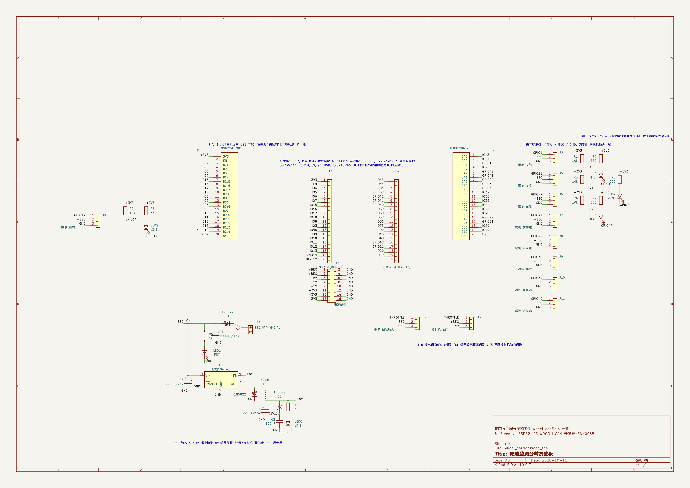
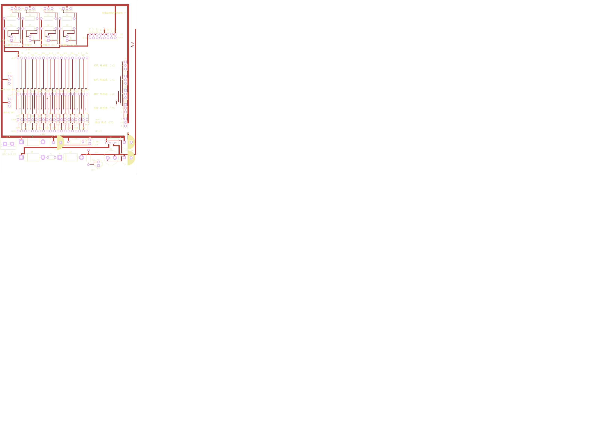

# 转接底板（硬件 v4）

轮速监测台的转接底板：原理图 + PCB 布局布线，全部脚本生成。Freenove
ESP32-S3 WROOM CAM 开发板插在底板的两个 20 针排母上，霍尔、舵机、遥控、电源
的接线全部从底板的端子上走；开发板全部 40 针另有 1:1 的扩展排针，将来固件
用到新脚不用重新打板。板子 96 × 122mm，双层，四角 M2.5 安装孔。





- **图纸**：用 KiCad 打开 `wheel_carrier/wheel_carrier.kicad_pro`（双击即可）。
- **生成器**：`scripts/gen_schematic.py`（原理图）+ `scripts/gen_pcb.py`（PCB），
  内容全是脚本里的常量，改完重跑就出新版。
- **验证状态**：原理图 ERC 0/0；PCB DRC 0 错误、**丝印类告警 0 条**（余量见下
  「已知接受项」）；Gerber + 钻孔文件已导出（`wheel_carrier/wheel_carrier-gerber.zip`，
  可直接传嘉立创）。

## 这块板做什么

| 项目 | 说明 |
|---|---|
| 开发板封装 | 2 个 20 针排母（J1 左排 = 3V3 那列，J2 右排 = 43 那列） |
| 扩展排针 | **J13/J14 直连开发板全部 40 针（1:1）**；J15 电源条（2×8：BEC×2 / 5V×3 / 3V3×3，其余 8 针全地） |
| 电调 / 油门 | J16 收电调的 3 针插头（BEC 进板）；油门信号经底板直通到 J17 → 接接收机油门通道 |
| 电源输入 | J12 两针螺丝端子进 **BEC 6~7.4V**（电调 BEC 输出） |
| +BEC 主路 | 防反接后分给：9 个接口的 +V 脚（舵机/接收机/霍尔）、C1 大电容、降压段 |
| 5V 降压 | LM2596T-5.0 + 47µH 电感 + 续流管 + 输入/输出电容，降到 5V 只供开发板 |
| 防倒灌 | D2 串在给开发板的支路上，USB 与底板供电互不倒灌 |
| 霍尔 ×4 | J3 左前 / J4 右前 / J5 左后 / J6 右后，各配 10k 上拉到 3.3V |
| 霍尔指示 | 每路信号一个 330R + 红灯：**亮 = 磁铁触发**（信号被拉低），转起来能看到闪烁 |
| 舵机 ×2 | J7 前差速 / J8 后差速 |
| 遥控 ×3 | J9 模式 / J10 前差速 / J11 后差速（顺带给接收机供 BEC 电压） |
| 大电容 | C1 1000µF/16V 兜舵机堵转的瞬时电流 |
| 指示灯 | LED1 绿灯 = +BEC 已上电；LED6 绿灯 = 降压段有 5V 输出 |

接口全是 3 针、顺序统一 **信号 / +V（BEC 电压）/ GND**，舵机和接收机的标准插头
直接能插。信号脚的 GPIO 分配与固件 `main/wheel_config.h` 完全一致，软件一行不用改。

### 引脚映射（与固件 wheel_config.h 一致）

| 接口 | 接到开发板排针 | GPIO |
|---|---|---|
| 霍尔·左前 J3 | J2 第 3 针 | 1 |
| 霍尔·右前 J4 | J1 第 19 针 | 14 |
| 霍尔·左后 J5 | J2 第 17 针 | 21 |
| 霍尔·右后 J6 | J2 第 16 针 | 47 |
| 舵机·前差速 J7 | J2 第 6 针 | 41 |
| 舵机·后差速 J8 | J2 第 5 针 | 42 |
| 遥控·模式 J9 | J2 第 9 针 | 38 |
| 遥控·前差速 J10 | J2 第 8 针 | 39 |
| 遥控·后差速 J11 | J2 第 7 针 | 40 |
| 开发板 5V 输入 | J1 第 20 针 | — |
| 开发板 3.3V（上拉与指示取电） | J1 第 1 针 | — |
| 开发板 GND | J2 第 20 针 | — |

排针针号 1 从**远离 USB 口**的一端数起，四个 20 针排针的 1 脚都在最左端
（丝印上有实心三角标），每一针的网名（3V3 / IO4 / IO47…）都印在排针旁边，
装板前对一遍即可；J13/J14 的针号与 J1/J2 一一对应（J13 第 n 针 = J1 第 n 针，
J14 = J2），排针右端另有 J13=J1、J14=J2 标注。

### 扩展排针的用法与红线

将来固件要用新 GPIO（比如二期 IMU 的 I2C），把杜邦线插到 J13/J14 对应针上就行。
引出的脚跟排母是 1:1 并联的，接外设等于并联一支，原功能不受影响。但有几条红线：

| 引脚 | 情况 |
|---|---|
| 35 / 36 / 37 | PSRAM 数据线，接任何外部电路都会把 PSRAM 弄坏（能拿表测，不能接东西） |
| 19 / 20 | 原生 USB 的 D-/D+。用 USB 口烧录/调试时不能接；改走 CH343 口烧录才可复用 |
| 0 / 3 / 45 / 46 | 启动模式脚：上电瞬间被采样，外部电路拉着它们会进不了正常启动 |
| 4–18 | 摄像头位（IO4/IO5 是 I2C）。要复用先拔摄像头排线 |
| 43 / 44 | 板载 CH343 串口，占着烧录通道，别动 |

### 电源条（J15）与电调口（J16/J17）

- **J15 是 2×8 电源条**：上排 8 针是电源（西→东：3V3、3V3、3V3、5V、5V、5V、BEC、BEC），
  下排 8 针全是对应的 GND——每一列「电源 + 地」相邻，两针的杜邦壳插一列就能给传感器
  供电，GND 管够（每个传感器、每根探针都要一根地）。
- **J16 收电调的 3 针插头**：BEC 电压从这里进板（三针插头中间那根必是 +V，
  插反只会信号线和地线换位，电源接不反），油门信号也从这里进板。
- **J17 去接收机**：用三针杜邦线接到接收机的油门通道。板载直通走线把 J16/J17 的
  信号针连通——油门信号「过板」，但那根直通是纯铜走线，**板子不通电也照传信号**，
  主控不在线不会断油门；J17 的 +V 顺带把电送给接收机（同 J9~J11）。
- 进电方式二选一（或都用）：J12 螺丝端子（粗线 / 大电流）或 J16（即插即用）。
  **同一时间只允许一个电源来源**——别把两路不同电源同时接进这两种入口。

## 设计决定的理由

**电源条为什么是 2×8、每列配一根地。** 一根 2.54 针只插得下一根杜邦线——原版
4 针的电源口挂两个传感器就不够分。传感器真正费的是针位（每台都要电源+地两根），
所以 v4 把电源口扩成 2×8：8 路电源、8 根地按列配对。信号类的预留继续走 J13/J14
扩展排针——不给每个设想都做专用口，真到接线烦了再加。

**电调口（J16/J17）为什么让油门过板。** 电调的三针插头直接插板子，BEC 从口上进
（与 J12 同一个节点，粗线大电流仍旧可以走端子）；油门信号用板上直通走线送到 J17
再回接收机。代价是油门路径多了两个插头，换来的是接线只有两根（电调到板、板到
接收机），而且以后固件想读油门（油门 + 四轮速算滑移率）信号点就在板上，加一根
跳线到空闲 GPIO 即可。

**为什么把 40 针全部引出来。** 固件还在长（二期有 IMU），下一个功能用哪根脚
说不准；把没在用的脚也引到扩展排针，将来插线即用、不用重新打板。这也是为什么
画在布局之前——原理图阶段加两排针几乎零成本。2.54 杜邦级够接传感器/模块；
真到要大功率或专用连接器的扩展（电机驱动之类），那还是得动板子。

**BEC 的 6/7.4V 不能直接进开发板。** 开发板 5V 脚是按 5V 设计的，7.4V 灌进去
会烧板上的 5V 器件、还会倒灌 USB。所以板上用 **LM2596T-5.0** 做了一路真降压：
TO-220 直插好焊、6~7.4V 进不发热、嘉立创几块钱，配 47µH 电感、续流管、输入
（220µF/25V）输出（220µF/16V）电容，就是这款芯片的教科书接法。

**舵机、接收机、霍尔走 BEC 原电压。** 这是车载惯例——你的舵机和接收机在车上
本来就是直接吃 BEC 的。由此出一件事要确认：**BEC 档位要跟舵机/接收机耐压匹配**
（6V 是通用档；7.4V 需要 HV 舵机）。霍尔无所谓，A3144 标称 4.5~24V，6~7.4V
完全在范围内。

**6V 档时 5V 段会略低于 5.0V，属正常。** BEC 6V 经防反接二极管掉到约 5.6V，
LM2596 在这个压差下接近直通、输出大约 4.9~5.1V。这没有关系：5V 段只供开发板，
开发板的 3.3V 稳压器输入 4.5V 以上就正常工作。7.4V 档时稳压在 5.0V。

**霍尔供电走 BEC、信号上拉走 3.3V。** 之前 3.3V 供电的隐患（A3144 规格下限
4.5V）彻底解决；上拉电压 3.3V 决定 GPIO 高电平，开集电极输出对 ESP32 安全。

**霍尔指示灯的接法与门道。** 每路信号从 3.3V 经 330R 串一个 LED 到信号脚：
信号被传感器拉低（磁铁靠近）时电流导通、灯亮；信号为高时 LED 两端等电位、自动
熄灭。电流约 4mA，在 A3144 的 20mA 灌电流能力之内，也不会把信号拉到读不出低电平。
用 3.3V 而不是 BEC 是刻意的：LED 只借用信号线当"回路"，不往信号里引入 BEC 电压。

**开发板供电串了第二只肖特基 D2。** 插着 USB 调程序时，5V 段和 USB 5V 会在开发
板上顶牛（互相倒灌）。串上之后两边都能单独供电，谁先谁后都无所谓。

**电源网络用标签、不摆电源符号。** 电源符号和同名标签混用会触发 ERC 的
same_local_global_label 警告（本来就是同一张网），统一用标签表达。PWR_FLAG 是
例外——它不改网络名，只负责让 ERC 认可 +BEC/GND 母线有驱动源（降压芯片的
VIN/GND 是 power_in 引脚，没旗标 ERC 会点名）。

## PCB 设计要点

**布局**（`gen_pcb.py` 的 PLACEMENT 表，坐标为焊盘包围盒中心）：
顶部一排是霍尔接口 + 10k 上拉 + 330R/指示灯三行；中部的两个 20 针排母把开发板
架空；两侧/下方按「走线友好」排序——右侧舵机+遥控接口列的顺序（J8→J7→J11→
J10→J9）就是按各自 J2 目标针的 x 递增排的，B 层那五条走线因此不打结；扩展
排针 J13/J14 放在排母正下方，40 根 1:1 竖线呈「线帘」状；电源区在底部。

**布线**（TRACKS 表，直角折线 + 过孔换层）：
- 正面 F.Cu 走信号 + 电源：+BEC 用 1.0~1.5 宽的主干（舵机堵转电流路径），
  +3V3/+5V 0.5~0.8，信号 0.3；开发板 40 针到扩展排针的竖线利用了排母行列间的
  1.27mm 间隙，左排靠一次 B 层借道绕开 J2 行。
- 背面 B.Cu 是整板 GND 铺铜 + 少量跨板长走线（四条霍尔信号、五条遥控/舵机、
  DEV_5V 东缘通道）；GND 焊盘靠铺铜的热焊盘自动连通，被走线围死的少数几处
  改成实心连接。被走线/焊盘净空四面围死的铺铜碎块会被 KiCad 当孤岛自动删掉
  （漂浮铜不如不要）——发现哪块该铺没铺，就补一根 GND 线把它缝回主铺铜：
  J1 上方那条带子（四周是霍尔信号线和焊盘排的净空）就是靠一根 0.3mm 的
  GND 线从第 8/9 针间隙穿下去缝上的。
- 每个过孔、每段净空都是对着 DRC 报告逐条磨出来的；`gen_pcb.py` 里那些
  「x=... y=...」的注释坐标不是随意摆的，改动前先跑 DRC。

**丝印标注**（`build_silk()`：139 条文字 + 4 个 1 脚三角标，坐标表就在函数里）：

- 九个接口旁印**功能名 + GPIO 号**（如「左后霍尔 IO21」「舵机 前差速 IO41」），
  3 针接口的 S / +V / G 就标在各自焊盘边上，插线不用查图纸；
- J1/J2 与 J13/J14 **每一针的网名**（3V3 / IO4 / IO47…）错行排在排针旁，
  开发板插装、将来插杜邦线都靠它；
- J15 电源条每个电源脚把自己的电压竖标在所在列的正上方（3V3×3 / 5V×3 / BEC×2），
  下排两端各标一个 GND——一眼读出「上排电源、下排地、每列一对」；
  J16/J17 印功能名（「电调 BEC 输入」「接收机 油门」）；J12 端子下方有 +/- 极性
  和「BEC 6~7.4V」；三条电源母线标了 +BEC / +3V3 / +5V，两个绿灯标了用途；
  右上角是板名与版本。
- 网名不手写——`io_name()` 从网表取，原理图改了 GPIO 分配，构建会直接报错
  而不是印出过期的号；写完先过 `check_silk()` 的几何自检（逐条文字对 166 个
  焊盘开窗、板边、其他文字做包围盒检查），再过 KiCad DRC 复核。

**DRC 与导出的正确姿势**（顺序敏感）：

```bash
CLI=/Applications/KiCad/KiCad.app/Contents/MacOS/kicad-cli
python3 scripts/gen_pcb.py                        # 重新生成（未填铺铜）
"$CLI" pcb drc --refill-zones --save-board \
    --output /tmp/pcb_drc.rpt wheel_carrier/wheel_carrier.kicad_pcb   # 重填铺铜+存回
"$CLI" pcb export gerbers --output wheel_carrier/gerber/ wheel_carrier/wheel_carrier.kicad_pcb
"$CLI" pcb export drill --output wheel_carrier/gerber/ --format excellon \
    --excellon-units mm wheel_carrier/wheel_carrier.kicad_pcb
```

坑：`pcb drc` 不带 `--refill-zones` 时**不填铺铜**，GND 会报几十条假「未连接」；
带上 `--save-board` 才会把铺铜写回文件（gerber 也才有铜皮）。生成器重跑会清掉
铺铜，导出前记得再走一遍这个流程。

另一个坑：kicad-cli 的部分操作（导出/DRC）会把 `.kicad_pro` 重写成完整版，
顺手把 `lib_footprint_mismatch` 的降级忽略丢掉（二十来条警告复活）。
`gen_pcb.py` 每次运行会自动把这条设置补回（自愈），别手工去跟它较劲。

**已知接受项**（都是丝印/外观级，不影响打样与功能）：
- 丝印类告警已清零：位号挪位（`REF_MOVES`）+ 文字几何自检之后，`silk_overlap`
  与 `silk_over_copper` 均为 0 条；
- 1 条 `unconnected`：LED1 的 GND 脚另配了一根到 C1 地脚的走线兜底（那个焊盘
  四周被走线围住、只经铺铜连通，DRC 对这类连通报提示），功能无碍；
- `lib_footprint_mismatch` 已在 `.kicad_pro` 里降级忽略（我们有意改了位号
  字号和部分焊盘）；U1 的焊盘按板厂 DFM 从 0.775 放到了 1.4。

## BOM（42 个元件，全部直插，方便手焊）

| 位号 | 元件 | 封装 |
|---|---|---|
| J1, J2 | 1×20 排母 | PinSocket_1x20_P2.54mm_Vertical |
| J13, J14 | 1×20 排针（扩展） | PinHeader_1x20_P2.54mm_Vertical |
| J15 | 2×8 排针（电源条） | PinHeader_2x08_P2.54mm_Vertical |
| J3–J11, J16, J17 | 1×3 排针 ×11 | PinHeader_1x03_P2.54mm_Vertical |
| J12 | 2 位 5.0mm 螺丝端子 | MX126-5.0-02P（或同类 bornier） |
| U1 | LM2596T-5.0（固定 5V 降压） | TO-220-5_Vertical |
| L1 | 47µH 直插电感 | L_Radial_D10.0mm（Fastron 07P 或同类） |
| D1 | 1N5824 肖特基（5A，走舵机总电流） | D_DO-201AD |
| D2, D3 | 1N5822 肖特基（3A；D3 是续流管） | D_DO-201AD |
| C1 | 1000µF/16V 电解 | CP_Radial_D10.0mm_P5.00mm |
| C3 | 220µF/25V 电解 | CP_Radial_D10.0mm_P5.00mm |
| C4 | 220µF/16V 电解 | CP_Radial_D10.0mm_P5.00mm |
| C2 | 100nF 瓷片 | C_Disc_D5.0mm |
| R1–R4 | 10k（霍尔上拉） | R_Axial_DIN0207（P10.16mm） |
| R5, R10 | 1k（电源指示限流） | 同上 |
| R6–R9 | 330R（霍尔指示限流） | 同上 |
| LED1, LED6 | 5mm 绿色（BEC / 5V 指示） | LED_D5.0mm |
| LED2–LED5 | 5mm 红色（霍尔指示） | LED_D5.0mm |

## 改图纸的姿势

两条路，选一条：

1. **改常量重跑**（推荐，图纸进 git、每版可复现）：
   ```bash
   python3 scripts/gen_schematic.py          # 原理图：.kicad_sch / .kicad_sym / 工程文件
   python3 scripts/gen_pcb.py                # PCB：.kicad_pcb（导 gerber 前记得重填铺铜，见上）
   ```
   布局常量、网络、元件表都在脚本顶部一节一节排好。
2. **直接在 KiCad 里改**：改完记得把改动同步回脚本，否则下次重跑会被覆盖。

自检三件套（改完跑一遍）：

```bash
CLI=/Applications/KiCad/KiCad.app/Contents/MacOS/kicad-cli
"$CLI" sch erc --severity-all --output /tmp/erc.rpt wheel_carrier/wheel_carrier.kicad_sch
"$CLI" sch export netlist --format kicadsexpr --output /tmp/wheel.net wheel_carrier/wheel_carrier.kicad_sch
"$CLI" sch export pdf --output /tmp/sch.pdf wheel_carrier/wheel_carrier.kicad_sch
# PDF 转图目检：sips -s format png -Z 4400 /tmp/sch.pdf --out /tmp/sch.png
```

几条给后来人的提醒（全是实际踩过的坑）：

- 旋转 90° 摆放的器件，属性文字要写 90° 角度（相对符号）才会横排；而且 KiCad
  会把 180° 的文字翻正显示、同时反转左右对齐——旋转件文字用「居中」定位最省心。
- 密集区里，相邻器件的伸线端点如果落在同一坐标，两条网络会被静默短接（ERC 都
  不一定报）。上拉电阻那排就是这么撞过一回，改成了标签直贴引脚端点。生成器里的
  `g()` 会断言所有坐标在 1.27 网格上，但「同坐标」这类问题还是要靠网表核对。
- KiCad 官方库里不少器件是 `extends` 派生写法（比如 LM2596T-5 继承 LM2596T-12
  的图形）。`kicad_lib.resolve_symbol()` 会自动把父符号的图形/引脚并进来，直接
  用 `find_symbol` 会拿到没有引脚的空壳。
- **PCB 封装的原点在 1 号焊盘上，不是器件中心**：直接按「中心」摆位整体会偏
  半个身位——配好的脚位全错过、外框互相压（实测一次撞出 20 多处）。`gen_pcb.py`
  的 PLACEMENT 表坐标语义是「焊盘包围盒中心」，由脚本解析封装尺寸自动换算；
  手工加件、手改坐标时记住这个语义。
- **同网络的走线允许自然汇合**：走线冲突不一定要绕开，经常可以「把两段的同网
  成员接在一起」（比如霍尔信号直接汇进它在扩展排针的绕行竖线上）。这块板靠
  这一手把四条霍尔网和五条遥控/舵机网从「单层必打结」里救了出来；而冲突点
  不用肉眼找，DRC 报告会给精确到 0.01mm 的坐标。
- **丝印文字压到焊盘开窗会被阻焊裁掉**（字缺一块，不可接受）、压到器件自带
  丝印框只是外观告警。所以 `gen_pcb.py` 内置 `check_silk()`：每条文字对全部
  焊盘开窗、板边、其他文字做包围盒检查，不通过直接构建失败——比生成后再看
  DRC 报告改得快。注意校验用的是保守字宽（CJK 按 1.15 倍字号估），改字号后
  留的空档别贴着估出来的边。
- **旋转 270° 的器件改位号位置时，局部坐标的 x 在屏幕上是 y 方向**：R10 挪
  位号时改错了分量，字往下方跑了一格。`REF_MOVES` 表里的坐标都是各封装自己
  的局部系，改之前先把 `rot_off()` 的换算方向默写一遍。
- **位号默认位置是封装库给的**，好几个默认就压邻件（LED1/LED6 的位号压在
  R5/R10 焊盘上会被阻焊裁断、C4 的位号压在 C3 的丝印圆上）。这类问题不用等
  DRC：`check_silk()` 会把位号也当文字检查（`ref_local()` 保证自检读到的位置
  就是文件里写的位置），`REF_MOVES` 表收集所有需要挪的位号。

## 本版明确没做的事

- 保险丝、霍尔信号滤波电容（当前用不上，避免多焊点）
- 打样下单与回板焊接（下一步；gerber 已就绪）
- 传感器/接收机侧的线束加工（沿用现有线材即可）
- 转向通道输入口、I2C（MPU6050）专用口：v4 暂缓——这两样从 J13/J14 扩展排针
  拉杜邦就能用（任何空闲 GPIO 都在上面），真到接线嫌烦时再加一轮
